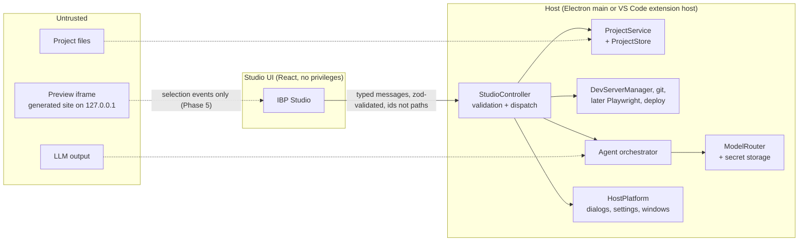

# IBP architecture overview

IBP (Intent Based Programming) is an AI-assisted environment for building, editing and maintaining
professional React websites. Non-programmers describe intent and click on the real site;
developers keep full access to the same source code.

IBP ships in two hosts that share all logic and stay feature-equal:

- **IBP desktop app** (Electron) — the standalone product.
- **IBP VS Code extension** — the same Studio inside VS Code, Cursor or VSCodium.

Status of each part: see [`../roadmap.md`](../roadmap.md). Decisions and rejected alternatives:
[`decisions.md`](decisions.md). Threat model: [`security.md`](security.md).

## Principles

- Low-code interaction, real-code output. Beginner and developer modes edit **one** project on disk.
- The preview is the project's real dev server (Vite or Next.js), never a mock.
- The host (Electron main process or VS Code extension host) is the only privileged component.
  The Studio UI and the preview only ask; the host validates.
- One implementation of the rules: `packages/core` holds every behaviour; hosts are thin adapters.
- No single model provider; free tiers are an option, not the foundation.

## Trust zones



## Layers and modules

| Layer         | Module                    | Phase | Responsibility                                                                                                                                                       |
| ------------- | ------------------------- | ----- | -------------------------------------------------------------------------------------------------------------------------------------------------------------------- |
| Experience    | `apps/webview`            | 1, A  | IBP Studio: projects, create (Vite or Next.js), overview, properties, settings, live preview with device sizes. Later chat and visual editor.                        |
| Host          | `apps/desktop`            | A     | Electron main + preload: window, `ibp://studio` protocol, IPC, native dialogs, JSON settings, packaging (Forge).                                                     |
| Host          | `apps/extension`          | 1, A  | VS Code adapter: webview panel + CSP, settings, `vscode.openFolder`, integrated terminal. Developer mode uses VS Code's editor, SCM and diff.                        |
| Contract      | `packages/shared`         | 1, A  | `protocol.ts` (messages, error codes, preview state), i18n dictionaries (pt-PT default, en).                                                                         |
| Core          | `packages/core`           | A     | `StudioController`, `HostPlatform`, `ProjectService`, `JsonProjectStore`, templates registry, `DevServerManager`, `ProcessRunner`, login-shell PATH resolution, git. |
| Model         | `packages/model-router`   | 2     | `ModelProvider` interface, OpenAI-compatible client (fetch + SSE), presets, capability probes, router with cooldowns and fallback, context trimming. No file system. |
| Model         | `packages/core/src/ai`    | 2     | `AiService`: provider settings (`ai.json`), keys via `HostPlatform.secrets`, tests/probes, usage log (`usage.jsonl`), chat streaming for the controller.             |
| Agent         | `packages/agent`          | 3     | `AgentAdapter`, in-house loop (plan, tools, checks, report), tool registry with risk levels and approvals, context collector, diff/revert through git.               |
| Developer     | editor, terminal, git     | B     | Desktop: Monaco editor + file tree, xterm/node-pty terminal, git panel and diffs. VS Code: native.                                                                   |
| Visual editor | `packages/preview-bridge` | 5     | Compile-time `data-ibp-src` attributes (Vite plugin, Turbopack loader for Next.js) + bridge script (hover outline, click → `postMessage`).                           |
| QA            | Playwright runner         | 6     | Build, type, lint, browser, responsive and accessibility checks; AI repair loop.                                                                                     |
| Deploy        | Vercel adapter            | 7     | Preview and production deployments with explicit approval.                                                                                                           |

Modules for later phases do not exist in the repository yet.

## Repository layout

```
IBP/
  apps/desktop/            Electron app. esbuild → dist/main.js, dist/preload.js; Forge → out/
    src/main.ts            window, ibp:// protocol, IPC sender checks, permissions
    src/preload.ts         window.ibpHost = { postMessage, onMessage }
    src/desktopHost.ts     HostPlatform for Electron
    src/settings.ts        userData/settings.json
    static/index.html      Studio page + CSP
    test/                  Playwright tests driving the real app
  apps/extension/          VS Code extension. esbuild → dist/extension.js
    src/vscodeHost.ts      HostPlatform for VS Code
    src/studio/            webview panel, HTML + CSP
    test/suite/            integration test inside VS Code (@vscode/test-cli)
  apps/webview/            IBP Studio React app (both hosts). Vite → apps/webview/dist
  packages/core/           @ibp/core: host-agnostic services (Node only)
  packages/shared/         @ibp/shared: protocol + i18n
  templates/shared/        sections, content, styles used by every template
  templates/base-vite-react/  Vite + React starter files
  templates/base-next/     Next.js (App Router) starter files
  docs/                    architecture, research, roadmap
```

## Key flows

**Create project.** Studio sends `projects/create {details, template}` → controller validates →
host folder picker → `ProjectService.create`: slug folder name, `mkdir` (fails if it exists),
copy `templates/shared` then the chosen template, fill placeholders (JSON-encoded / HTML-escaped),
write `.ibp/project.json`, `git init` + first commit when git has an identity → registry entry →
`state` pushed to the Studio.

**Install dependencies.** Explicit button → modal confirmation in the host → `DevServerManager`
runs `npm install` (argument array, no shell) in the project folder; output streams into the
preview log; when it finishes the project list is re-read.

**Live preview.** `preview/start {id}` → controller resolves the project → `DevServerManager`
checks `node_modules`, picks a free loopback port and runs the template's dev command
(`vite --host 127.0.0.1 --strictPort` or `next dev --hostname 127.0.0.1`), polls the URL until it
answers, then reports `running` + URL. The Studio shows it in a sandboxed cross-origin iframe at
desktop, tablet (768 px) or mobile (390 px) width. Stopping kills the whole process group; the
server also stops when the window or panel closes.

**Open project.** Desktop: becomes the current project (no reload). VS Code: `vscode.openFolder`
(window reloads); activation on `workspaceContains:.ibp/project.json` reopens the Studio and
registers projects cloned by teammates.

## Data

- Registry: `projects.json` in the host's storage (desktop `userData`, VS Code `globalStorage`) —
  id, path, name, archived, timestamps. Written atomically, writes serialised. Rebuildable.
- Project metadata: `<project>/.ibp/project.json` — id, name, client, industry, description, stack,
  template, createdAt. Committed with the project; never holds secrets.
- Settings: desktop `userData/settings.json`; VS Code `ibp.*` settings.
- Secrets (Phase 2): Electron `safeStorage` (async API) on desktop, `SecretStorage` in VS Code.

## Estimated complexity and risks

| Area                         | Complexity | Main risk                                                              | Mitigation                                                                                      |
| ---------------------------- | ---------- | ---------------------------------------------------------------------- | ----------------------------------------------------------------------------------------------- |
| Element → source mapping     | High       | Ambiguous mapping; Turbopack loaders support only part of webpack API  | Explicit `data-editor-id`, compile-time attributes per bundler, candidate picker fallback       |
| Agent quality on free models | High       | Weak tool calling, small context, rate limits                          | Capability probes, task-based routing, small context packs, user-provided paid keys as fallback |
| Two hosts kept in sync       | Medium     | Features drift between desktop and VS Code                             | All behaviour in `packages/core`; hosts only implement `HostPlatform`; tests for both hosts     |
| Built-in developer tools     | High       | Monaco/xterm integration; node-pty is a native module (rebuild per OS) | Milestone B; until then "View code" hands the folder to VS Code                                 |
| Free provider terms          | Medium     | Terms forbid resale/competing services; prompts may be logged          | Individual credentials, local gateway only, documented warnings                                 |
| Preview security             | Medium     | Generated code runs next to the Studio                                 | Cross-origin sandboxed iframe, loopback-only servers, no privileged path from preview           |
| `npm install`                | Medium     | Lifecycle scripts run with user rights                                 | Explicit approval; consider `--ignore-scripts` profiles later                                   |
| Distribution                 | Medium     | Unsigned macOS builds trigger Gatekeeper; Windows/Linux untested       | Apple Developer ID signing + notarization (decision pending), Windows/Linux in Phase 8          |
