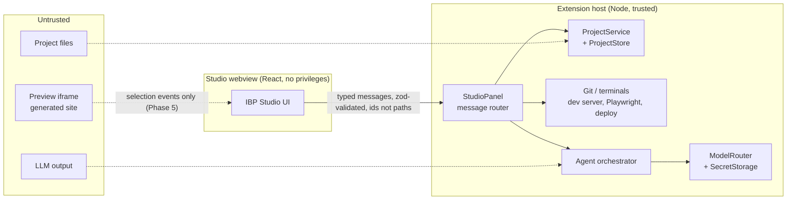

# IBP architecture overview

IBP (Intent Based Programming) is a VS Code extension for building, editing and maintaining
professional React websites. Non-programmers describe intent and click on the real site;
developers keep full access to the same source code through VS Code itself.

Status of each part: see [`../roadmap.md`](../roadmap.md). Decisions and rejected alternatives:
[`decisions.md`](decisions.md). Threat model: [`security.md`](security.md).

## Principles

- Low-code interaction, real-code output. Beginner and developer modes edit **one** project on disk.
- The preview is the real Vite dev server, never a mock.
- The extension host is the only privileged component. Everything else asks it, and it validates.
- No single model provider; free tiers are an option, not the foundation.

## Trust zones



## Layers and modules

| Layer         | Module                        | Phase | Responsibility                                                                                                                                         |
| ------------- | ----------------------------- | ----- | ------------------------------------------------------------------------------------------------------------------------------------------------------ |
| Experience    | `apps/webview`                | 1     | IBP Studio: project list, create/import, project overview, properties, settings. Later chat, preview, visual editor.                                   |
| Experience    | VS Code itself                | 1     | Developer mode: editor, explorer, terminal, SCM, diff. Not re-implemented.                                                                             |
| Contract      | `packages/shared`             | 1     | `protocol.ts` (message schemas, error codes), i18n dictionaries (pt-PT default, en).                                                                   |
| Runtime       | `apps/extension/src/projects` | 1     | `ProjectService` (create from template, import, update, archive), `JsonProjectStore`, `.ibp/project.json` metadata, git via `execFile`.                |
| Runtime       | `apps/extension/src/studio`   | 1     | Webview panel, CSP, message validation and dispatch.                                                                                                   |
| Model         | `packages/model-router`       | 2     | `ModelProvider` interface, OpenAI-compatible adapter, capability registry, router, retries/fallback, usage log, keys in `SecretStorage`.               |
| Agent         | `packages/agent`              | 3     | `AgentAdapter`, in-house loop (plan, tools, checks, report), tool registry with risk levels and approvals, context collector, diff/revert through git. |
| Runtime       | dev server manager            | 4     | Starts/stops `vite` per project, reports status and runtime errors.                                                                                    |
| Visual editor | `packages/preview-bridge`     | 5     | Dev-only Vite plugin: `data-ibp-src` attributes + bridge script (hover outline, click → `postMessage`).                                                |
| QA            | Playwright runner             | 6     | Build, type, lint, browser, responsive and accessibility checks; AI repair loop.                                                                       |
| Deploy        | Vercel adapter                | 7     | Preview and production deployments with explicit approval.                                                                                             |

Modules for later phases do not exist in the repository yet.

## Repository layout

```
IBP/
  apps/extension/          VS Code extension (host). esbuild → dist/extension.js
    src/extension.ts       activation, commands, status bar
    src/studio/            webview panel, HTML + CSP
    src/projects/          ProjectService, JsonProjectStore, metadata, git, folder names
    test/suite/            integration test run inside VS Code (@vscode/test-cli)
  apps/webview/            IBP Studio React app. Vite → apps/extension/dist/webview
  packages/shared/         @ibp/shared: protocol + i18n, consumed as TypeScript source
  templates/base-vite-react/  starter website copied on "create project"
  docs/                    architecture, research, roadmap
```

## Key flows (Phase 1)

**Create project.** Webview sends `projects/create {details}` → host validates → native folder
picker (host-side) → `ProjectService.create`: slug folder name, `mkdir` (fails if it exists),
copy template, fill placeholders (JSON-encoded / HTML-escaped), write `.ibp/project.json`,
`git init` + first commit when git has an identity → registry entry → `state` pushed to webview.

**Open project.** `projects/open {id}` → host resolves the path from the registry →
`vscode.openFolder` (window reloads) → activation on `workspaceContains:.ibp/project.json`
reopens the Studio and registers the project if a teammate cloned it.

**Install dependencies.** Explicit button → modal confirmation in the host → fixed command
`npm install` in a visible terminal whose `cwd` comes from the registry.

## Data

- Registry: `<globalStorage>/projects.json` — id, path, name, archived, timestamps. Written
  atomically, writes serialised. Can be rebuilt from project folders.
- Project metadata: `<project>/.ibp/project.json` — id, name, client, industry, description, stack,
  template, createdAt. Committed with the project; never holds secrets.
- Settings: `ibp.language`, `ibp.mode`, `ibp.theme`, `ibp.projectsRoot` (VS Code settings).
- Secrets (Phase 2): VS Code `SecretStorage` only.

## Estimated complexity and risks

| Area                         | Complexity | Main risk                                                      | Mitigation                                                                                                   |
| ---------------------------- | ---------- | -------------------------------------------------------------- | ------------------------------------------------------------------------------------------------------------ |
| Element → source mapping     | High       | Ambiguous mapping for loops, shared components, third-party UI | Explicit `data-editor-id`, compile-time `data-ibp-src`, candidate picker fallback; spike right after Phase 1 |
| Agent quality on free models | High       | Weak tool calling, small context, rate limits                  | Capability probes, task-based routing, small context packs, user-provided paid keys as fallback              |
| Free provider terms          | Medium     | Terms forbid resale/competing services; prompts may be logged  | Individual credentials, local gateway only, documented warnings                                              |
| Preview security             | Medium     | Generated code runs in a webview iframe                        | Separate origin, message allowlist, no privileged commands from preview                                      |
| `npm install`                | Medium     | Lifecycle scripts run with user rights                         | Explicit approval; consider `--ignore-scripts` profiles later                                                |
| Packaging as own IDE         | High       | Code - OSS fork maintenance, Marketplace unavailable           | Deferred to Phase 8; extension stays editor-agnostic                                                         |
